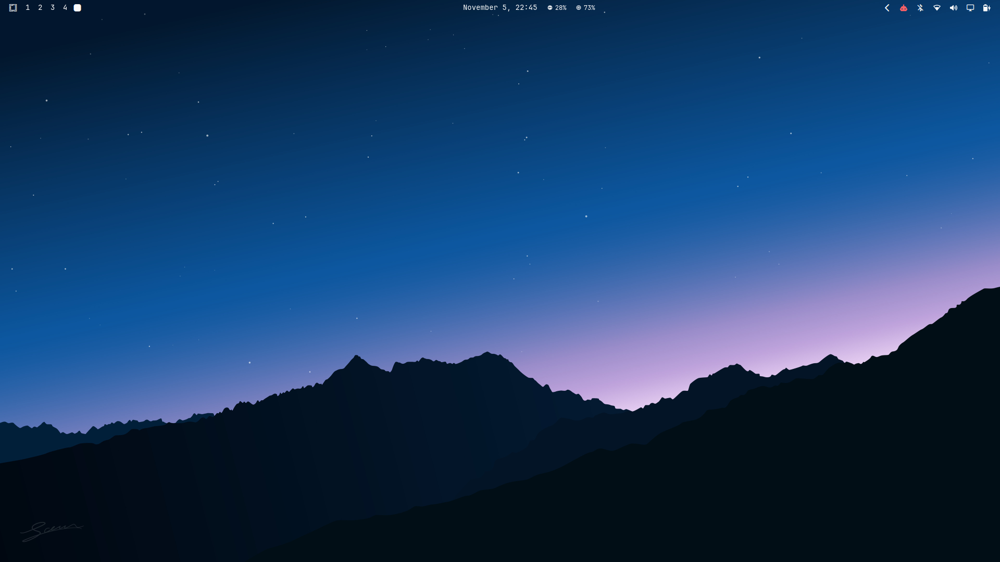
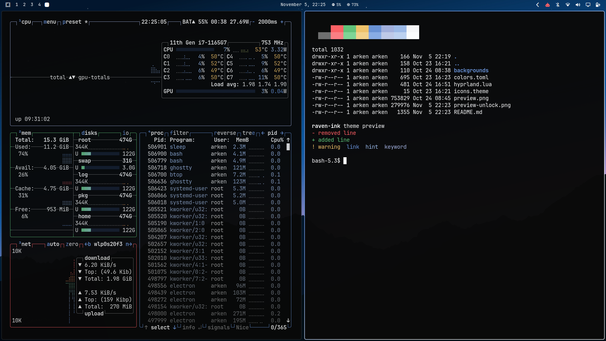
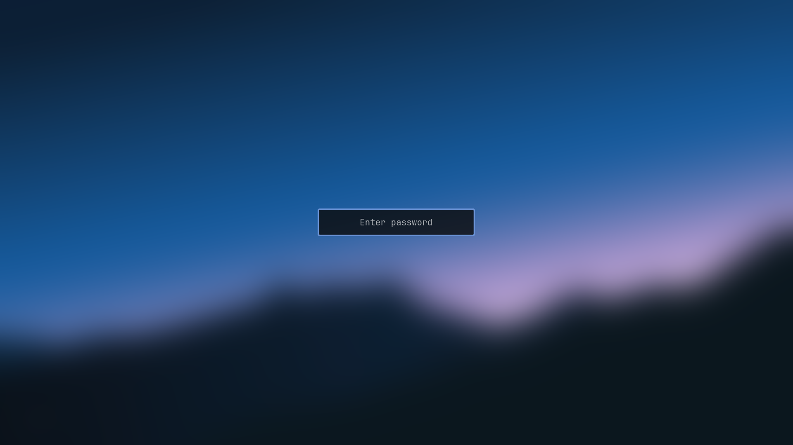

<p align="center">
  
</p>

<h1 align="center">Raven Ink</h1>

<p align="center">
  
  
  
</p>

A cool near-dark theme for my [Omarchy](https://omarchy.org/) laptop with one blue accent. Backgrounds are `#0a0a0a`, text is `#fafafa`, and the only color that isn't a gray or a status color is `#6b93d6`.

Built mainly by Claude, with many *angry* comments from me :)

## Installation

```sh
omarchy theme install https://github.com/0xherve/omarchy-raven-ink
```

Or via the menu (**Super + Alt + Space** → **Install > Style > Theme**), then paste the repo URL and press Enter.

The install applies the theme. To switch back to it later:

```sh
omarchy theme set raven-ink
```

For the blue border gradient, paste the contents of [`hyprland.lua`](hyprland.lua) into `~/.config/hypr/looknfeel.lua`. Omarchy drops Lua files from themes installed from a repo, so this step is manual. Skip it to keep Omarchy's default borders.

## Screenshots

| Apps | Lock screen |
|---|---|
|  |  |

There are 3 wallpapers in `backgrounds/`. Cycle through them with `omarchy theme bg next`.

## What's in it

| File | What it does |
|---|---|
| `colors.toml` | The palette. Omarchy builds every app's config from this file. |
| `hyprland.lua` | Window borders. Active windows get a blue to off-white gradient, inactive ones a dark gray. |
| `icons.theme` | Uses the `Yaru-blue-dark` icon set. |
| `backgrounds/` | The wallpapers. |
| `desktop.png`, `preview.png`, `preview-unlock.png` | The screenshots above. |

## Credits

The mountain silhouette wallpaper (`3-raven-ridge.jpg`) is by santapillow, via [Wallhaven](https://wallhaven.cc/w/w58vvr).

## License

The theme files are MIT licensed, see `LICENSE`. The wallpapers in `backgrounds/` are not covered by it.
